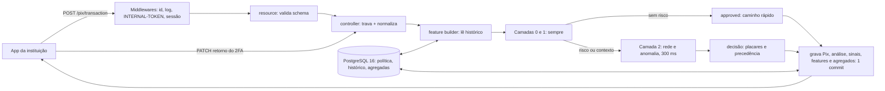
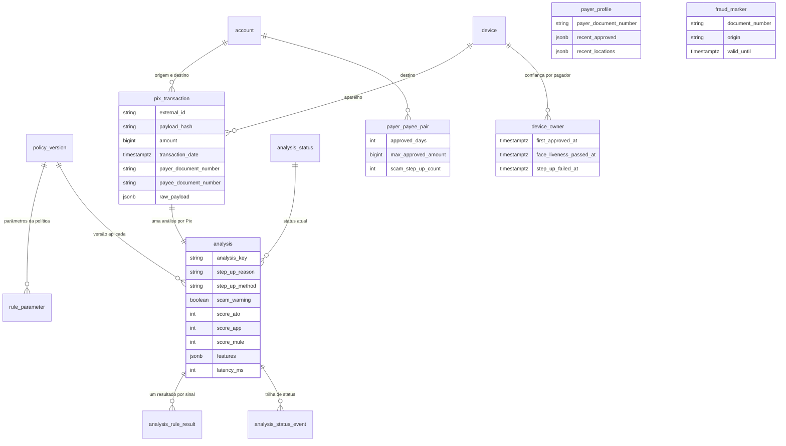

# RFC — Motor Antifraude Pix: decisão por tipo de fraude, antes do envio

| Campo | Valor |
|---|---|
| Grupo | 17 |
| Time | Eduardo Oliveira Rodrigues Cardoso · Ingrid Carvalho Godoy |
| Data | 17/10/2026 (versão 1) · 18/10/2026 (versão 2) |
| Versão | 2 |
| Repositório | github.com/eduardo3071/Hackathon-QI-Tech |

> **Versão 2.** Atualiza a versão 1 com o que foi construído e medido depois dela (bateria de realidade, Fases 3 a 5). Os itens que a versão 1 marcava "em implementação" estão prontos; a seção [O que mudou desde a versão 1](#o-que-mudou-desde-a-versão-1) lista as diferenças. O PDF da versão 1 tinha dois diagramas em imagem; aqui eles estão em Mermaid. Onde esta RFC e o código divergirem, valem o `README.md` e o `CLAUDE.md`.

## Contextualização

### Entendendo o problema

Depois que o Pix sai, a perda é quase total: em 2025 o MED devolveu só 9,3% do valor contestado, porque o dinheiro já foi pulverizado quando a vítima reclama ([BCB, MED 2.0](https://www.bcb.gov.br/content/estabilidadefinanceira/pix/MED/MED_2-0_Circuito_Pix-Dia_1.pdf)). A fraude média confirmada é de R$ 1.735, contra mediana de R$ 50 no Pix entre pessoas ([O POVO+/BCB](https://mais.opovo.com.br/reportagens-especiais/2026/07/24/a-cada-rs-100-em-golpes-no-pix-instituicoes-devolvem-apenas-rs-890.html)). A decisão precisa acontecer antes do envio, dentro dos 40 segundos que o BCB dá para liquidar.

A perda não vem só de senha roubada. Em 2024, 38% das marcações de fraude do DICT foram de conta de golpista e 27% de conta laranja ([Times Brasil](https://timesbrasil.com.br/brasil/economia-brasileira/prejuizo-com-fraudes-no-pix-cresce-70-e-atinge-r-49-bi-em-2024-mostram-dados-do-bc/)). São três formas de fraude, e cada uma pede uma resposta diferente:

- **Conta invadida:** outra pessoa opera a conta (celular roubado, troca de chip, acesso remoto). O segundo fator protege, porque o invasor não tem o rosto do titular.
- **Golpe:** o próprio titular, manipulado, faz o Pix (falsa central, falso parente, falso investimento). Ele passa em qualquer segundo fator; o que ajuda é um aviso na hora certa.
- **Conta laranja:** recebe e repassa o dinheiro das vítimas, em geral em menos de 1 hora ([RUSI via Outseer](https://www.outseer.com/blog/following-the-fraud-new-research-about-money-mule-networks)). O sinal está no recebedor.

O risco do lado oposto é travar quem só quer pagar o aluguel. Com cerca de 6,7 fraudes a cada 100 mil Pix, uma regra que pede 2FA em 1% dos Pix desafia uns 150 clientes legítimos para cada fraude real.

O sistema recebe cada Pix em `POST /pix/transaction` e responde `approved`, `two_factor_required` ou `rejected`, com o motivo. Usam o sistema o app da instituição, que pergunta antes de enviar o Pix, e o mesmo app, que devolve o resultado do 2FA.

**A garantia sobre a decisão:** o mesmo Pix nunca é avaliado duas vezes, Pix simultâneos do mesmo pagador não enganam as contagens, e toda decisão fica gravada com o motivo de cada sinal.

**Fora do escopo:** front-end; cadastro de contas; consulta real ao DICT (uma tabela local com o mesmo formato simula as marcações); serviços externos durante a decisão; o fluxo da biometria em si, que é do app.

### Explicando a solução de forma macro

Uma API REST em camadas (`resource → controller → repository → model`) sobre PostgreSQL 16, subindo com `docker compose`, feita a partir do Base Service. O motor responde duas perguntas antes de decidir: **quem está apertando o botão** e **para onde vai o dinheiro**. Cada sinal soma pontos num de três placares, e o placar que passa do corte escolhe a resposta.

A precedência é `rejected` > `two_factor_required` > `approved`. Cortes, pontos e limites moram na tabela `rule_parameter`, numa política versionada (`2026.10.1`), nunca no código.

| Placar | Pergunta | Corte | Resposta |
|---|---|---|---|
| `ato` (conta invadida) | Outra pessoa está operando a conta? | 60 | 2FA com biometria facial (`face_liveness`) |
| `app` (golpe) | O titular está sendo manipulado? | 60; aviso de 30 a 59 | 2FA com aviso de golpe; de 30 a 59, aprova com aviso |
| `mule` (conta laranja) | O recebedor se comporta como laranja? | 60 com 2 sinais diferentes | Recusa; com um sinal só, 2FA com aviso de golpe |

A avaliação é em camadas para o Pix comum ser rápido. As camadas 0 e 1 rodam sempre: marcação, limites de norma, velocidade e a leitura das tabelas agregadas (perfil, par pagador-recebedor, dono do aparelho). Sem sinal e sem contexto de risco (destino sem histórico, aparelho não confiável, noite), o Pix sai aprovado pelo caminho rápido. Só com risco roda a camada 2 (sinais de rede e o modelo de anomalia), com tempo limite de 300 ms; se estourar, sai 2FA, nunca aprovação no escuro.

Toda decisão grava o Pix, a análise, um resultado por sinal (inclusive os que passaram) e as features usadas, num commit só. O perfil do pagador é feito só de Pix aprovados: tentativa recusada não ensina o motor, mas conta na velocidade. Na borda ficam os middlewares do Base Service: identificador e log por requisição, `INTERNAL-TOKEN` e sessão com rollback.

#### Arquitetura: do Pix à decisão

O Pix sem risco sai aprovado logo depois das camadas 0 e 1; só o Pix com sinal ou contexto de risco passa pela camada 2.

### O que foi considerado e descartado

- **Recusar todo Pix com cara de golpe:** descartado porque quem paga é o dono de verdade, e uma recusa sem evidência dura trava o cliente legítimo. O golpe recebe 2FA com aviso; a recusa fica para marcação, conta esvaziada e laranja com dois sinais. *Ganharia com uma lista confiável de recebedores golpistas.*
- **2FA único para qualquer risco:** descartado porque a vítima de golpe passa em qualquer segundo fator; na Europa, transferências com autenticação forte tiveram fraude maior ([EBA-ECB 2025](https://www.ecb.europa.eu/press/intro/publications/pdf/ecb.ebaecb202512.en.pdf)). O método e o aviso mudam com o tipo de fraude.
- **Reter o Pix pelo timer de 30/60 minutos:** descartado porque o contrato só tem três status e a decisão é síncrona. *Ganharia num contrato com status de retenção.*
- **ML supervisionado:** descartado porque não há rótulo confiável de fraude, e contestação não é fraude. Usamos detecção de anomalia (Isolation Forest) em modo observação (sombra). *Ganharia com histórico rotulado da instituição.*
- **Blockchain:** descartado porque o problema é decidir em milissegundos, não registrar sem confiança. Se a integridade do histórico precisar de prova, o caminho é uma cadeia de hashes no próprio PostgreSQL (próximo passo, **não implementado**).
- **Período de aprendizado para cliente novo:** descartado porque liberava até R$ 1.000 em aparelho nunca visto, contra a Res. BCB 403. No lugar, o cadastro do aparelho com biometria (`device_registration`), uma vez só.
- **Perfil com todo Pix aprovado:** descartado porque o golpe confirmado pela vítima ensinava o motor a aceitar o próximo. O Pix aprovado depois de 2FA de golpe não entra no perfil.
- **Destino "recorrente" com um único Pix aprovado:** descartado porque o falso investimento (R$ 500, 1.000, 3.000, 8.000 ao mesmo destino) passava inteiro. Agora exige 2 Pix em dias diferentes e valor até 1,5× o maior já pago.
- **Trava de linha (`SELECT … FOR UPDATE`):** descartado porque o primeiro Pix de um pagador não tem linha para travar. A trava consultiva (`pg_advisory_xact_lock`) vale sobre a chave, exista a linha ou não. *Ganharia com contas já cadastradas.*

## Implementação

### Rotas

Convenções: recurso no singular, em inglês. O `id` do Pix vem do cliente; a `key` (UUID) sai na resposta e o id interno do banco nunca sai. Valores em centavos. Erro sempre com `title`, `description`, `translation` e `code`. 400 é pedido fora do schema; 404 é Pix que não existe; 422 é pedido bem formado que a regra recusa; 409 é estado que não permite. Toda rota, menos `/` e `/health_check`, exige `INTERNAL-TOKEN` (403 sem ele). A recusa antifraude não é erro HTTP: é 201 com `status: rejected`.

| Método | Caminho | O que faz | Entrada (campos que importam) | Saídas (status e quando) |
|---|---|---|---|---|
| POST | `/pix/transaction` | Avalia o Pix e grava a decisão | `id`, `amount`, `transaction_date`, contas e titulares de origem e destino, `device_id`, `channel`, `ip`, `geolocation` (opcional) | 201 com `{key, status, metadata}`; 200 repetição com o mesmo `id` e o mesmo conteúdo, sem reavaliar; 409 `QIT001002` mesmo `id` com outro conteúdo; 422 `QIT001003` CPF/CNPJ inválido; 422 `QIT001004` data inválida; 422 `QIT001006` IP inválido; 400 `QIT000001` fora do schema; 403 `QIT000002` sem token |
| GET | `/pix/transaction/{id}` | Devolve o dossiê: decisão, placares, cada sinal com valor observado e limite, trilha de status | — | 200; 404 `QIT001001` |
| PATCH | `/pix/transaction/{id}` | Retorno do 2FA: muda o status e ensina o motor | `two_factor_result` (`passed` ou `failed`), `completed_at` | 200 com o dossiê; 409 `QIT001009` Pix que não pediu 2FA; 409 `QIT001008` resultado do 2FA já registrado; 422 `QIT001007` 2FA concluído antes do Pix; 404; 400 |

A idempotência do POST compara o hash do payload normalizado (`payload_hash`): o app que reenvia o Pix por falha de rede recebe a mesma decisão, e a velocidade não conta o Pix duas vezes. O `PATCH` é uma rota isolada e removível: se a QI Tech disser que está fora do escopo, ela sai sem quebrar o `POST` nem o `GET`.

### Regras e decisão

São 8 regras compostas, com 25 sinais. Cada sinal devolve `pass`, `warn`, `two_factor`, `reject`, `not_evaluated` (sem dado) ou `not_needed` (dispensado), com pontos para um placar.

| Regra | Sinais | O que pega |
|---|---|---|
| 1. Marcação | `lista` | Pagador ou recebedor marcado por fraude (simula o DICT) |
| 2. Limite por contexto | `aparelho_nao_cadastrado`, `noturno`, `sem_geolocalizacao`, `noturno_fora_de_casa` | Limites de norma: aparelho novo, noite, geolocalização desligada (não para a empresa no aparelho e no canal de sempre); à noite, longe de casa, para destino novo, o teto noturno sem exceção (coação) |
| 3. Ritmo | `velocidade`, `fracionamento`, `destinos_novos` | Rajada de Pix, Pix dividido para fugir do limite, rajada para destinos novos |
| 4. Perfil | `valor`, `escalada` | Valor fora do histórico: acima do P95 e de 5× a mediana em 90 dias. Destino recorrente atenua; para destino novo, compara com o histórico de destinos novos; loja PJ antiga só avisa. Valores crescentes para o mesmo destino em 7 dias (falso investimento) |
| 5. Quem opera | `aparelho_compartilhado`, `viagem_impossivel`, `fora_da_zona`, `canal_incomum`, `ip_compartilhado` | Indícios de que outra pessoa está com a conta |
| 6. Conta recebedora | `conta_nova`, `fan_in`, `dormente`, `varias_instituicoes`, `suspeita_anterior`, `primeiro_pix_alto` | Recebedor com cara de laranja ou já ligado a golpe; primeiro Pix alto para conta PF recém-aberta (falso parente) |
| 7. Rastro | `repasse_rapido`, `proximidade_marcada`, `conta_pagadora_recente` | Dinheiro que entra e sai em minutos; ligação com conta marcada |
| 8. Anomalia | `ml` (Isolation Forest) | Padrões que nenhuma regra cobre; em modo sombra, não muda a decisão |

**Quando o motor pede 2FA.** O cliente legítimo só vê 2FA em quatro situações. A confirmação no app só vale com aparelho confiável no lugar de sempre; fora disso, o motor pede biometria.

| Motivo (`step_up_reason`) | Quando acontece | Método | Aviso de golpe |
|---|---|---|---|
| `device_registration` | Cliente que o motor não conhece, de aparelho novo, acima de R$ 200 por Pix ou R$ 1.000 no dia, sem outro risco. Uma vez só: aprovada a biometria, o aparelho fica confiável | `face_liveness` | não |
| `account_takeover` | Aparelho não confiável acima do limite com outro risco; 5 Pix em 10 min somando R$ 1.000 ou mais; 3 destinos novos em 10 min somando R$ 2.000 ou mais; viagem impossível; fora da zona; placar `ato` ≥ 60 | `face_liveness` | só se também houver suspeita de golpe |
| `possible_scam` | Placar `app` ≥ 60 (valor muito acima do perfil para destino novo; destino que já teve 2FA de golpe) ou placar `mule` ≥ 60 com um sinal só | `in_app_confirmation`; `face_liveness` com aparelho não confiável, biometria reprovada em 24 h ou Pix a mais de 5 km dos locais de sempre | sim |
| `limit` | Soma noturna PF→PF acima de R$ 1.000 e do maior Pix noturno já aprovado; Pix acima de R$ 500 sem geolocalização; Pix picado abaixo dos limites | `in_app_confirmation`, com a mesma troca para biometria | não |

Sem 2FA, o motor ainda tem duas saídas. Aprova com aviso (`recommended_action: warn`) quando o placar `app` fica entre 30 e 59: é o golpe de sinal fraco, em que 2FA não ajuda e recusar seria fricção demais. E recusa só com evidência dura:

1. Pagador ou recebedor marcado por fraude.
2. 10 Pix em 10 minutos somando R$ 1.000 ou mais.
3. Placar `mule` ≥ 60 com 2 ou mais sinais diferentes de laranja.
4. Recebedor que recebeu de conta marcada nas últimas 24 horas (1 salto).
5. Pix noturno PF→PF para destino novo, a mais de 5 km dos locais habituais, com a soma noturna acima de R$ 1.000 (`LIMITE.noturno_fora_de_casa`): o teto da Res. BCB 142 sem exceção no contexto de coação, em que a vítima passa no próprio 2FA.

**Depois do 2FA, o `PATCH` ensina o motor.** Biometria aprovada torna o aparelho confiável. Biometria reprovada (por qualquer motivo do 2FA) bloqueia a confiança no aparelho por 24 h. Golpe confirmado pela vítima **não entra no perfil nem torna o destino recorrente**, para o golpe não ensinar o motor a aceitar o próximo; ainda assim, por 90 dias, um novo Pix fora do perfil para o mesmo destino pede 2FA de novo (`suspeita_anterior`), exceto o padrão de conta do mês (valor até 25% parecido, 20 dias depois).

### Base legal

O Banco Central já fixou metade dos parâmetros do motor; a outra metade são estimativas declaradas e calibráveis, marcadas assim no README.

| Norma ou decisão | O que diz | Onde entra no motor |
|---|---|---|
| Res. BCB 403/2024 | Aparelho não cadastrado: até R$ 200 por Pix e R$ 1.000 por dia, cadastro com 2FA. Exige solução de risco que identifique transações "não compatíveis com o perfil do cliente" | `aparelho_nao_cadastrado`, `device_registration`, `PERFIL.valor` |
| Res. BCB 142/2021 | R$ 1.000 entre 20h e 6h para Pix entre pessoas físicas distintas; aumento de limite só vale depois de 24 h | `LIMITE.noturno` |
| IN BCB 669/2025 (Fórum Pix) | Limite menor, inclusive zero, com a geolocalização desligada | `LIMITE.sem_geolocalizacao` |
| Res. BCB 147/2021, art. 39-B | Fatores de suspeita no recebedor: notificações, tempo desde a abertura da conta, horário, perfil do pagador | Regra 6, conta recebedora |
| Res. BCB 587/2026 | Rejeitar todas as transações de usuário e conta marcados, como pagador ou recebedor | `MARCACAO.lista` |
| Res. BCB 506/2025 | Limites só com base em critério de risco de fraude ou lavagem | Legitima limites que mudam com o perfil |
| Manual de Tempos do Pix | Liquidação em até 40 s; timer de fraude não vale entre contas do mesmo titular | Caminho rápido; mesma titularidade |
| Alerta de golpe do BCB | Alerta de golpe para transações atípicas | `scam_warning` e a faixa de aviso |
| MED 2.0 | Rastreio do dinheiro de golpe além da primeira conta | `RASTRO.proximidade_marcada` |
| STJ, REsp 2.209.868 (2026) | Sem transação incompatível com o perfil, o banco não responde pelo golpe da falsa central | O motivo gravado em cada análise é prova de diligência |
| LGPD, art. 11, II, "g" ([texto](https://www.planalto.gov.br/ccivil_03/_ato2015-2018/2018/lei/l13709.htm)) | Permite tratar dado sensível para "garantia da prevenção à fraude e à segurança do titular, nos processos de identificação e autenticação de cadastro em sistemas eletrônicos"; a biometria é tratada pelo app, o motor só recebe o resultado do 2FA | `face_liveness`; nada pessoal em log. Enquadramento a confirmar com o jurídico da QI Tech |

O mercado usa as mesmas ideias: o Modo Rua do Nubank reduz o limite fora do local seguro e pede reconhecimento facial acima dele ([Nubank](https://international.nubank.com.br/pt-br/consumidores/carnaval-seguro-pioneiro-modo-rua-do-nubank-ja-protege-mais-de-5-milhoes-de-clientes/)), e o Alerta Pix do Itaú avisa antes de concluir a transferência suspeita.

### Banco de dados (13 tabelas)

`payer_profile` e `fraud_marker` ligam-se aos demais pelo documento (CPF/CNPJ normalizado), não por chave estrangeira. As tabelas agregadas (`payer_profile`, `payer_payee_pair`, `device_owner`) são atualizadas no mesmo commit de cada Pix.

## Fluxos

**Pix do dia a dia: caminho rápido (`POST /pix/transaction`)**

1. Normaliza documentos e horário (Brasília) e calcula o hash do payload.
2. Trava o `id` do Pix, o pagador, o recebedor PF e o aparelho com `pg_advisory_xact_lock`, em ordem crescente de chave.
3. Se o `id` já existe com o mesmo hash, devolve 200 com a decisão gravada; com outro hash, 409.
4. Camadas 0 e 1: aparelho confiável, destino recorrente, valor dentro do perfil, nenhum sinal.
5. Sem contexto de risco, sai `approved` com `metadata.path = "fast"`. Grava Pix, análise, resultados e agregados num commit; 201. A latência (`latency_ms`) é gravada em cada análise; **veja a seção de resultados: ela depende da máquina**.

**Conta invadida: celular roubado**

1. O ladrão tenta R$ 1.500 de um aparelho que o titular nunca usou.
2. `LIMITE.aparelho_nao_cadastrado`: acima de R$ 200 em aparelho não confiável. Sai `two_factor_required` com `account_takeover` e `face_liveness`.
3. O ladrão reprova na biometria; o app manda `PATCH` com `failed`. O Pix vai para `rejected`, o evento entra na trilha e o aparelho fica sem confiança por 24 h.

**Golpe: falsa central**

1. A vítima, no celular de sempre, manda R$ 4.800 para um destino novo, mais de 10× a sua mediana.
2. `PERFIL.valor` no segundo degrau dá 60 pontos de golpe. Sai `two_factor_required` com `possible_scam`, `in_app_confirmation` e `scam_warning: true`.
3. Se a vítima confirma mesmo assim, o Pix sai aprovado, mas **não entra no perfil**: o próximo Pix para o golpista (R$ 4.500, depois R$ 3.900) pede 2FA de novo, porque o perfil continua sem aprender o valor do golpe.

**Conta laranja: várias vítimas para a mesma conta**

1. Uma conta PF aberta há 7 dias recebe de pagadores diferentes na mesma hora.
2. A conta nova converge com menos pagadores: a partir de **3 pagadores somando R$ 1.000 ou mais**, `CONTA_RECEBEDORA.fan_in` (+40) soma com `conta_nova` (+20 pela idade, ou +60 no primeiro crédito fora do perfil), no placar `mule`, com dois sinais diferentes.
3. Sai `rejected` com tipologia `mule_account`; o motivo de cada sinal fica no dossiê. (Para conta com mais de 30 dias valem 5 pagadores.)

**Falha: dez Pix simultâneos do mesmo pagador**

1. Dez pedidos chegam juntos; todos disputam a trava do pagador.
2. Cada um, ao pegar a trava, lê a contagem já atualizada pelos anteriores. O 5º na janela de 10 minutos pede 2FA; o 10º, com a janela somando R$ 1.000 ou mais, é recusado.
3. Sem a trava, os dez leriam a mesma contagem zero e todos passariam.

## Principal desafio

**Qual é:** separar, em milissegundos e só com o payload e o histórico próprio, quem está sendo atacado de quem está só pagando o aluguel, e dar a cada tipo de fraude a resposta que funciona para ele.

**Por que é difícil:** a fraude é rara (cerca de 6,7 a cada 100 mil Pix), então qualquer regra larga pune milhares de clientes legítimos para pegar uma fraude. A vítima de golpe passa em qualquer 2FA, porque é ela mesma que autentica. O motor só vê os Pix da própria instituição, e as contagens (velocidade, fan-in, soma do dia) quebram com Pix simultâneos.

**Como o desenho resolve:**

1. Placares separados por tipo de fraude: biometria para invasão, aviso para golpe, recusa só com evidência dura.
2. Sinais que combinam evidências: conta nova sozinha pontua pouco; conta nova com fan-in recusa.
3. Camadas com caminho rápido: o Pix comum não paga pelas verificações pesadas.
4. Trava consultiva em ordem fixa e idempotência por hash: Pix simultâneos e repetidos não enganam as contagens.
5. Perfil só com Pix aprovados e limpos: tentativa recusada e golpe confirmado não ensinam o motor.
6. Parâmetros no banco, com fonte ou marcados como estimativa: dá para calibrar sem mudar código.

Os testes por HTTP provam com cenários (193 testes): dez Pix simultâneos do mesmo pagador decidem como em fila; seis pagadores ao mesmo tempo para a mesma conta PF contam todos no fan-in.

## Resultados e limitações (versão 2)

**Leia antes dos números.** O simulador e a bateria de realidade são do próprio grupo: os cenários de fraude foram desenhados por nós, conhecendo as regras. Os números são **teste de regressão e medida de fricção, não eficácia**.

**Simulador** (semente 2, 6.915 Pix; `docs/resultados-simulador.md`):

| Tipologia | Versão 1 (pego, Pix) | Versão 2 (pego, Pix) |
|---|---:|---:|
| Conta invadida | 51,5% | 63,1% |
| Golpe | 37,5% | 43,8% |
| Conta laranja | 70,5% | 100% |
| Padrão novo (nenhuma regra cobre) | 0% | 0% |

Clientes legítimos: **2,1% de 2FA na versão 1 e 2,8% na versão 2**, 0% de recusa nas duas. O aumento vem do cadastro do aparelho (64 dos 188 Pix legítimos com 2FA são `device_registration`: o primeiro Pix acima de R$ 200 de cada cliente, de propósito) e de 8 Pix de folha de pagamento que já pediam 2FA por outro motivo.

**Bateria de realidade** (90 clientes por 60 dias e 12 golpes encenados; `docs/bateria-realidade.md`): travam a falsa central (os 3 Pix), o falso investimento (a partir do salto), a falsa venda (3º comprador), a mão fantasma (3º Pix), o SIM swap, a laranja de passagem, a fazenda de contas e a marcação.

**Limitações conhecidas:**

- **Falso parente:** resolvido na bateria (`primeiro_pix_alto`); continua aberto para conta com mais de 30 dias ou valor abaixo de R$ 1.000.
- **Celular roubado na rua:** resolvido na bateria (local habitual só depois de 24 h; Pix noturno longe de casa para destino novo é recusado); continua aberto perto da casa da vítima.
- **Teste de contas** (Pix de centavos): só o ML pegaria, e em modo sombra ele só registra.
- **Coação:** coberta à noite, longe de casa, para destino novo (a quinta forma de recusar); continua aberta perto de casa e para destino recorrente. Próximos passos no app: senha de coação, lugares seguros, aumento de limite com 24 h de espera.
- **Latência:** na primeira rodada, em outro ambiente, o p95 do caminho rápido foi de 48 ms. Na máquina usada na entrega (Windows com Docker Desktop) o p95 passa de 200 ms. **Não prometemos um número sem medir na máquina da demonstração.**
- **Visibilidade:** o motor só vê Pix da própria instituição; repasse rápido, fan-in, conta dormente e proximidade de conta marcada dependem disso. O caminho para superar é a consulta ao DICT.

## O que mudou desde a versão 1

| Tema | Versão 1 | Versão 2 |
|---|---|---|
| `device_registration`, `RITMO.destinos_novos`, golpe confirmado fora do perfil | "em implementação" | Prontos |
| Cliente desconhecido | Cadastro do aparelho previsto | Cadastro do aparelho com `face_liveness`; sem período de aprendizado |
| Destino recorrente | Qualquer Pix aprovado | 2 Pix em dias diferentes e valor até 1,5× o maior já pago |
| Perfil de destino novo | Perfil geral | Compara com o histórico de destinos novos (a partir de 5 casos) |
| Conta do mês | `suspeita_anterior` punia o mês seguinte | Não pune valor até 25% parecido, 20 dias depois |
| Loja PJ antiga | Podia pedir 2FA com aviso de golpe | No máximo aviso (conta de 1 ano ou mais) |
| Fan-in | 5 pagadores em 1 h | 5 pagadores e R$ 1.000 na janela; 3 pagadores para conta nova |
| Método do 2FA | Confirmação no app para golpe e limite | Biometria com aparelho não confiável, biometria reprovada em 24 h ou Pix a mais de 5 km do costume |
| Biometria reprovada | Bloqueava o aparelho só por suspeita de invasão | Bloqueia por 24 h em qualquer 2FA com biometria |
| Nº de sinais | cerca de 20 | 22 |
| Resultados | "antes das correções em curso": 2,1% de 2FA | Medidos de novo: 2,8% de 2FA em legítimos |

**Ajustes finais (18/10), depois da versão 2:**

| Tema | Antes | Agora |
|---|---|---|
| Falso parente (F2 da bateria) | Passava quando o pagador já mandava valores altos a destinos novos | `CONTA_RECEBEDORA.primeiro_pix_alto`: primeiro Pix de R$ 1.000 ou mais para PF com conta de < 30 dias → 2FA com aviso de golpe |
| Falso investimento | Cada Pix, sozinho, parecia normal | `PERFIL.escalada`: Pix crescentes para o mesmo destino em 7 dias, o atual ≥ 3× o primeiro → 2FA com aviso a partir de R$ 300 |
| Salário pago pela empresa | Sem geolocalização, todo Pix > R$ 500 pedia 2FA | `LIMITE.sem_geolocalizacao` não se aplica ao PJ no aparelho confiável e no canal de sempre |
| Celular roubado na rua (F6) | O Pix aprovado na rua virava "local habitual" na hora | Local só vira habitual 24 h depois, para o método do 2FA e para a coação |
| Coação (F8) | A vítima coagida passava no 2FA | `LIMITE.noturno_fora_de_casa` → `rejected`: a quinta forma de recusar |
| Nº de sinais | 22 | 25 |
